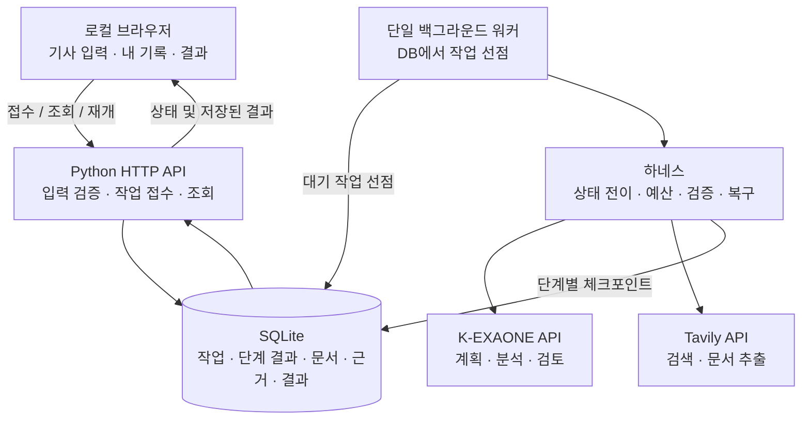
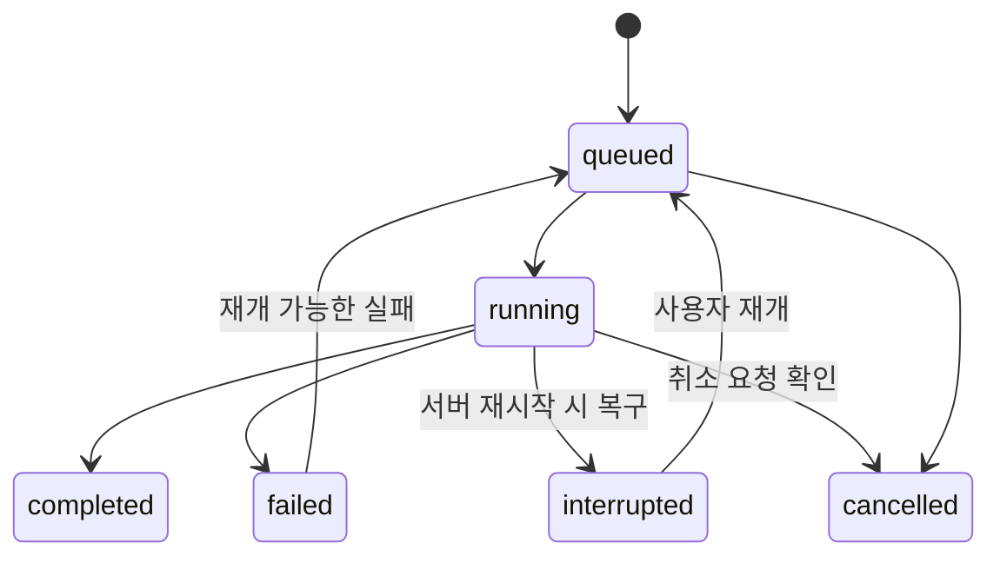

# GRAY 로컬 조사·분석 하네스 설계안

상태: 기본 하네스 구현 완료. 제한된 보완 검색과 나머지 운영 검증은 후속 범위다. 기존 경량 동기 분석과 구분한다.
대상: 로컬 단일 사용자 데모, Python + SQLite + K-EXAONE + Tavily.

## 1. 목적과 완료 기준

기사에서 제기된 쟁점을 찾고, 관련 자료에 등장하는 입장과 그 근거를 연결해 기록한다. 사실 여부를 판정하거나 기계적으로 찬성·반대·중립을 만들어내지 않는다.

하네스는 작업 순서·허용 도구·호출 예산·검증·재시도·저장을 책임진다. LLM은 기사 이해·조사 계획·자료 해석·검토를 담당한다. LLM이 임의로 도구나 파일을 실행하지 않는다.

완료 조건:
- 모든 표시 관점에 최소 하나의 유효한 근거 ID가 있다.
- 모든 근거는 확보한 문서의 특정 구절과 연결된다.
- 쟁점에 없는 자료를 억지로 연결하지 않는다.
- 다른 관점을 확보하지 못한 쟁점은 부족 사유를 표시한다.
- 필수 검증을 통과하면 completed, 자료 한계가 있으면 completed + limitations, 구조·근거 검증을 통과하지 못하면 failed다.
- 자료 한계를 공개하는 것과 잘못된 출처 연결을 허용하는 것은 다르다.

## 2. 사용자 흐름

기사 URL/본문 → 분석 맡기기 → 접수 완료 → 내 기록 → 진행 상태 → 완료 결과 열기.

내 기록은 새 작업과 기존 브라우저 저장 결과를 함께 표시한다. 새 작업은 SQLite가 원본이다. 기존 localStorage 기록은 자동으로 삭제하거나 서버로 옮기지 않고 ‘기존 저장 기록’으로 구분한다.

단계 문구: 대기 중 / 기사 확인 중 / 조사 계획 중 / 자료 수집 중 / 관점 정리 중 / 근거 검토 중 / 보완 조사 중 / 완료 / 일부 자료 부족 / 실패 / 중단됨.
퍼센트는 표시하지 않는다. 완료 시각을 예측하지 않는다. 시간은 등록·시작·마지막 갱신 시각을 표시한다.

브라우저 종료 후에도 서버가 켜져 있으면 계속 진행한다. 서버 종료 시 진행 중 호출은 복구되지 않는다. 재시작 시 interrupted로 바꾸고 사용자 재개를 기다린다.

## 3. 아키텍처



한 프로세스에 HTTP 서버와 워커 스레드 하나를 둔다. 외부 메시지 큐·벡터 DB·에이전트 프레임워크는 초기 범위에 포함하지 않는다. SQLite 연결은 스레드마다 생성하고 WAL·busy_timeout을 적용한다. 네트워크 요청 중 DB 트랜잭션을 열어 두지 않는다.

## 4. 단계별 계약

### 0. 접수와 원문 확보 — Python / 필요 시 Extract 1회

입력: `{url?, text?}`. 둘 다 있으면 text 우선. 최대 50,000자. 빈 값·잘못된 타입·자격 증명이 포함된 URL 거부.
출력: `article = {input_type, original_url, text, content_hash, obtained_at, coverage}`.
URL 추출 실패는 ARTICLE_UNAVAILABLE로 종료하고 본문 입력을 안내한다. 추출 결과가 로그인/차단/메뉴 페이지인지 점검하고 불확실하면 원문으로 인정하지 않는다.
URL 리디렉션은 provider가 반환한 URL을 따로 저장한다. 원문 일치가 불명확하면 성공으로 취급하지 않는다.
50,000자 안의 기사 전체를 계획 단계에 전달한다. 자동 절단으로 전체를 분석했다고 주장하지 않는다. 외부 API 입력 크기를 초과하면 조용히 자르지 않고 입력 축소를 안내한다.

### 1. 기사 이해와 조사 계획 — LLM 1회

입력: 원문 전체와 고정된 계획 프롬프트.
출력:
```json
{
  "title": "기사 주제",
  "summary": "원문에서 제기한 핵심 내용",
  "issues": [{
    "id": "I1",
    "question": "검토할 쟁점",
    "article_claims": [{"actor": "기사의 발언 주체", "claim": "주장", "article_quote": "원문 구절"}],
    "needs": ["공식 해명", "다른 입장", "수치의 배경"],
    "queries": [{"query": "검색어", "purpose": "official_response", "expected_source": "공식 발표"}]
  }]
}
```
상한: 쟁점 2개, 전체 검색어 4개. 검색어에는 사건명·주체·시점을 넣는다. ‘반박’만 반복 검색하지 않는다.
검증: article_quote가 원문에 실제 존재하는지 공백 정규화 후 검사. 인물·수치의 외부 진위는 판정하지 않는다. 문제가 없거나 비교 가능한 쟁점이 없으면 검색 없이 적합하지 않은 입력임을 안내한다.

### 2. 자료 수집 — Python + Tavily

검색 최대 4회, 각 최대 5개 결과를 확보한다. 검색 결과에는 query ID, 검색 시각, 제목, URL, 내용, 제공된 발행일을 저장한다. 발행일을 모르면 null이다.
URL의 추적 파라미터·fragment만 정리하고 의미 있는 query는 보존한다. 동일 URL은 합치되 같은 언론사라는 이유로 서로 다른 자료를 삭제하지 않는다.
최종 문서 최대 8개. 입력 원문은 별도 A1로 관리하며 이 숫자에 포함하지 않는다.
선정 순서: 해당 사건·시점과의 일치 → 주장에 직접 관련 → 공식 답변/당사자 입장/배경 자료의 빈칸 보완 → 같은 보도 반복 제외.
매체의 정치 성향으로 순위를 매기지 않는다. 공식 자료도 당사자의 발표로 표현한다.
제목에 ‘공식’이 있다는 이유로 공식 자료로 분류하지 않는다. 도메인·발행 주체를 확인할 수 없으면 source_type=unknown이다.

선택 문서 최대 6개를 Extract로 본문 확보한다. 배치 요청을 사용하되 문서 수로 예산을 센다. 추출 실패 문서는 snippet_only로 보존한다.
문서 필드: `document_id, url, canonical_url, title, publisher, published_at, retrieved_at, source_type, text, content_hash, coverage(full|excerpt|snippet_only), selection_reason`.
후보 전부를 LLM에 넣지 않고 선정 문서만 전달한다. 본문 크기 예산을 초과하면 excerpt로 명시하고 생략 범위를 기록한다.

### 3. 근거 추출과 관점 초안 — LLM 1회

입력: 계획·원문·선정 문서. 문서마다 서버가 부여한 ID와 coverage를 제공한다.
출력: `evidence[]`, `issues[]`, `gaps[]`.

근거 항목:
```json
{
  "id": "E1", "issue_id": "I1", "document_id": "D2",
  "quote": "확보한 문서의 실제 구절",
  "interpretation": "이 구절이 보여주는 입장",
  "relation": "supports", "coverage": "full"
}
```
관점 항목: `{id, issue_id, actor, claim, evidence_ids, caveat}`. 쟁점당 최대 3개. relation은 supports / challenges / context 중 하나다. 서로 다른 주장을 단순 찬반으로 뭉개지 않는다.
부족 항목: `{issue_id, missing, reason, proposed_query}`.

하드 검증:
- ID 참조가 실제 존재하는가.
- quote가 해당 문서의 저장된 본문 안에 있는가. 공백만 정규화하고 문장을 유사하다는 이유로 통과시키지 않는다.
- 모델이 URL·날짜·발행 주체를 새로 생성하지 않았는가.
- quote만 존재하고 무관한 주장을 붙이지 않았는지는 다음 검토 단계가 다룬다.
- 문서 구절의 존재는 사실의 진위를 의미하지 않는다.
- snippet_only는 ‘검색 발췌문 기준’으로 표시하고 원문 전체를 확인한 것처럼 서술하지 않는다.

### 4. 근거 검토 — LLM 1회 + Python 게이트

입력: 원문·관점 초안·인용 구절·해당 문서의 필요한 주변 문맥. 초안 작성 프롬프트 대신 검토 전용 프롬프트로 호출한다.
출력: `checks[{perspective_id, verdict, reason, evidence_ids}], gaps[], repair_needed`.
verdict: supported / overstatement / mismatched / insufficient.

검토 질문:
1. 근거가 실제로 해당 주체의 해당 주장을 지지하는가.
2. 보도된 의혹을 확정된 사건처럼 바꾸지 않았는가.
3. 공식 부인과 다른 주장에 동일한 확인 기준을 적용했는가.
4. 시점이 다른 자료를 같은 사건의 답변처럼 사용하지 않았는가.
5. ‘언급 없음’을 반대 의견으로 해석하지 않았는가.
6. 배경 설명을 ‘중립적 결론’으로 포장하지 않았는가.

같은 모델의 검토는 독립적인 진실 검증이 아니다. quote 일치 검사는 Python이 결정하고 의미 연결은 검토 결과와 사용자 확인에 의존한다. 숫자 신뢰도 점수를 만들어내지 않는다.

### 5. 제한된 보완 — 조건부 검색 최대 2회 + LLM 최대 1회

실행 조건: 핵심 관점의 근거 연결이 실패했거나, 원문에서 특정된 실제 상대 입장/공식 답변을 아직 확보하지 못했고 검토자가 구체적인 검색어를 제안한 경우.
단순히 찬반 숫자가 다르다는 이유로 보완하지 않는다.
보완 전 계획·수집을 처음부터 재실행하지 않는다. 문제 쟁점과 관련 문서만 전달한다. 전체 문서 상한 8개를 유지하며 최대 2개를 교체한다. 전체 Extract 상한 6개는 유지한다.
마지막 LLM은 보완 자료에서 근거 추출·검토를 함께 수행하고 자신이 수정한 항목을 식별한다. 이후 Python 하드 검증을 다시 적용한다. 별도 의미 검토를 한 번 더 통과한 것처럼 표시하지 않는다.
보완 후에도 invalid quote/존재하지 않는 ID는 제거한다. 지지되지 않는 관점은 제외하고 사유를 공개한다. 더 이상의 자동 조사 루프는 실행하지 않는다.
모든 표시 관점이 제거되면 결과 품질 실패로 종료한다. 비교할 입장이 하나만 남으면 한 관점과 자료 한계를 표시할 수 있다.

### 6. 조립과 완료 — Python

LLM에게 이미 검증된 결과를 다시 문장화시키지 않는다. 승인된 관점과 근거로 UI version:1 형식을 만든다.
기존 title/summary/issues/perspectives/sourceIds/sources는 유지한다. 선택 필드로 evidenceIds, limitations, coverage, researchMeta를 추가한다.
sourceIds는 evidence의 document_id를 따라 서버에서 계산한다. 미사용 문서는 참고자료와 실제 인용 출처를 구분해 보관한다.
완료 결과는 SQLite에 저장한다. UI의 내 기록을 다시 열 때 외부 API를 호출하지 않는다.

## 5. 실행 예산 — 초기값, 실측 후 조정

| 항목 | 상한 |
|---|---:|
| 대기 작업 | 10개 |
| 동시 실행 | 1개 |
| 비교 쟁점 / 관점 | 2개 / 쟁점당 3개 |
| 기본 LLM 호출 | 3회: 계획·초안·검토 |
| 보완 LLM 호출 | 1회 |
| 자동 LLM 재요청 | 전체 작업에서 추가 2회 이내 |
| LLM HTTP 시도 총합 | 최대 6회 |
| 검색 | 기본 4회 + 보완 2회 |
| 문서 | 최대 8개 + 입력 원문 |
| 외부 문서 추출 | 최대 6개, 입력 URL 추출 1개 별도 |
| 단일 LLM 요청 | 180초 |
| 작업 총 경과 | 15분 |

예산은 실행 전에 예약하고 DB에 기록한다. 429·네트워크 실패·형식 복구도 요청 횟수에 포함한다. 총 경과 제한은 호출 사이에 검사하고 각 호출의 timeout도 남은 작업 시간 이하로 설정한다. socket timeout이 완벽한 프로세스 강제 종료는 아니라는 한계는 남는다.
LLM 출력 토큰은 초기 8,192로 두며 긴 추론 후 JSON이 잘리면 완료시키지 않는다. 토큰 상한은 품질 보증이 아니다.
429는 Retry-After가 작업 예산 안이면 기다리고 같은 단계를 재시도한다. 일일 한도 등 긴 제한은 retryable 실패로 표시한다. 401/403은 자동 재시도하지 않는다.

## 6. 상태·체크포인트·재개

job.status: queued / running / completed / failed / interrupted / cancelled.
job.stage: article / plan / retrieve / draft / review / repair / finalize.



stage 종료 시 산출물·검증 결과·사용량과 다음 단계를 한 트랜잭션으로 저장한다. 검증 실패 산출물은 완료 체크포인트로 표시하지 않는다.
재개는 마지막 성공 단계 다음부터 실행한다. prompt_version·모델·입력 해시가 달라지면 기존 단계 재사용을 거부하고 새 작업을 만든다.
실행 중 단계는 외부 API 응답을 받았더라도 DB 저장 전에 종료되면 다시 호출될 수 있다. exactly-once나 중복 과금 방지를 보장하지 않는다.
워커 선점은 BEGIN IMMEDIATE에서 queued 한 건을 running으로 전이시키고 즉시 커밋한다. 별도 프로세스 두 개 실행은 지원하지 않는다.
취소는 cancel_requested를 저장하고 도구 호출 전후에 확인한다. 이미 진행 중인 외부 요청은 즉시 중단하지 못할 수 있다. 이후 요청과 결과 반영은 막는다.

## 7. SQLite 최소 구조

jobs: id(UUID), status, stage, article_json, input_hash, prompt_version, model, budget_json, usage_json, error_code, error_message, retryable, cancel_requested, created_at, updated_at, started_at.
stages: job_id, stage, attempt, status, input_hash, output_json, validation_json, duration_ms, created_at. 완료 체크포인트는 unique(job_id,stage,input_hash)로 식별한다.
documents: job_id, document_id, metadata_json, text, content_hash.
evidence: job_id, evidence_id, issue_id, document_id, quote, interpretation, quote_valid.
results: job_id(PK), schema_version, result_json, limitations_json, completed_at.

원문·문서·근거는 API 요청 로그에 넣지 않고 로컬 DB에만 저장한다. 로그에는 job_id, stage, attempt, 경과 시간, 상태 코드, 토큰 수만 기록한다. 예외 원문을 그대로 로그에 출력하지 않는다.
DB는 data/gray.sqlite에 두고 Git 제외 및 HTTP 접근 차단을 적용한다. 데이터는 사용자가 작업을 삭제할 때 관련 행도 트랜잭션으로 삭제한다. SQLite 삭제가 디스크에서 안전한 영구 소거를 보장하지는 않는다.

## 8. API 계약

| API | 반환·동작 |
|---|---|
| POST /api/jobs | {url?,text?} → 202 {id,status,stage} |
| GET /api/jobs?limit=20&before=... | 원문 없는 목록 {items,nextCursor}; 최대 50개 |
| GET /api/jobs/{id} | 상태·시각·단계·안전한 오류; completed일 때만 result |
| POST /api/jobs/{id}/resume | failed/interrupted이며 retryable일 때 202; 그 외 409 |
| POST /api/jobs/{id}/cancel | 취소 요청 반영; 완료 작업에는 409 |
| DELETE /api/jobs/{id} | running은 409; 나머지 데이터 연쇄 삭제 |

400 입력 오류 / 404 작업 없음 / 409 상태 충돌 / 429 큐 가득 참. 접수 이후 외부 API 실패는 조회 응답의 job.status=failed로 전달한다. 키나 upstream 응답 전문은 반환하지 않는다.
중복 제출은 같은 입력 해시의 queued/running 작업이 있으면 그 작업 ID를 돌려준다. 완료 기록의 강제 재분석은 새 작업으로 명시한다.
화면은 작업 실행 시 5초 간격으로 조회하고 탭이 숨겨지면 30초 간격 또는 중지한다. 통신 오류가 나면 느리게 재시도하며 완료·실패 시 polling을 멈춘다.
현재 동기 POST /api/analyze는 전환 기간 유지하고 새 UI는 jobs만 사용한다. 검수용 수동 결과는 실제 작업 상태와 구분한다.

## 9. 보안·개인 기록 경계

로컬 단일 사용자이므로 계정별 권한을 구현했다고 표현하지 않는다. 같은 컴퓨터에서 해당 서버에 접근할 수 있으면 기록을 읽을 수 있다.
서버는 127.0.0.1에만 바인딩한다. 조회·변경 모든 API에서 Host를 확인하고 변경 요청은 application/json과 Origin을 검증한다. 임의 CORS를 허용하지 않는다.
정적 파일은 공개 파일 allowlist를 유지한다. .env·DB·Python 소스·문서 파일은 HTTP 제공 대상에서 제외한다.
외부 자료는 지시가 아닌 데이터다. 도구 목록·호스트·예산·파일 경로는 Python이 결정한다. 셸 실행·임의 함수 호출·환경변수 접근을 LLM에 허용하지 않는다.
검색 URL도 http/https와 자격 증명 여부를 검사한다. 추출은 Tavily를 통해 수행하며 로컬 서버가 임의 URL을 직접 가져오지 않는다.
출력은 기존 textContent 기반 렌더링을 유지한다. 출처 링크는 URL 검증 후 연결하고 noopener noreferrer를 유지한다.

## 10. 파일별 책임과 구현 경계

- server.py: HTTP·정적 파일 제공·입력 검증·서버/워커 시작과 종료.
- job_store.py: 스키마·작업 선점·체크포인트·조회·재개·삭제. sqlite3만 사용.
- harness.py: 워커와 단계 실행·예산·재시도·취소 확인·결과 조립.
- research.py: EXAONE/Tavily 호출·자료 정리·출처와 인용 검증. 현재 함수 이동 시 보안 로직 유지.
- prompts.py: 계획·초안·검토·보완 프롬프트 및 출력 계약·버전.
- index.html: 접수 완료·작업 목록·상태 polling·완료 결과 열기. 기존 결과 렌더러 재사용.
- assets/app.css: 작업 상태 카드와 오류·자료 한계 표시.
- data/gray.sqlite: 실행 시 생성, Git 제외.

개발자 A: job_store / research / harness / API / 테스트. 개발자 B: 접수와 내 기록·상태·근거 구절 펼치기. 먼저 샘플 job JSON으로 병렬 개발한다. 6주·낮은 주당 투입량 조건에서는 보완 조사를 마지막 증분으로 둔다.

## 11. 수용 검증

자동: 작업 선점 중복 방지, 단계 체크포인트 재개, 중단 복구, quote 및 ID 위조 거부, 429 예산 소진, JSON 실패, 취소 후 추가 호출 방지, 키·DB 정적 접근 차단, 기존 저장 기록 호환.
수동: 서로 다른 입장이 있는 기사 / 입장이 하나만 확보되는 기사 / 숫자·날짜를 다르게 인용한 기사 각 1건.
검토표: 관점별 인용이 저장 문서에 존재하는가, 주체·사건·시점이 맞는가, 의미를 과장했는가, 부족 자료를 공개했는가. 소수 표본 결과를 일반적인 정확도 지표로 표현하지 않는다.
성공: 접수 즉시 ID 반환, 브라우저 종료 후 완료 결과 재열람, 재시작 후 명시적 재개, 지지되지 않은 관점을 성공 결과에 넣지 않기. 응답 속도 단축은 이 설계의 보장 항목이 아니다.
